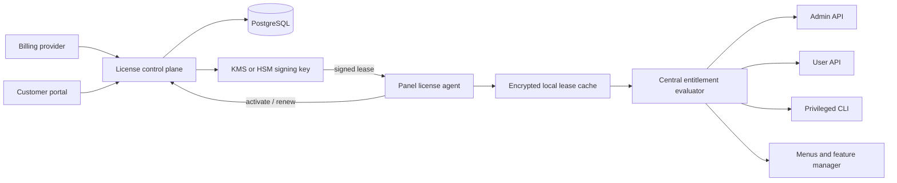

# OpenPanel Enterprise License Audit and Independent Licensing Architecture

## Summary

OpenPanel's current Enterprise check combines a plaintext license key, public-IP binding, an online status endpoint, a short local grace cache, UI feature flags, per-plan feature files, and several route-specific checks. The code is functional but enforcement is distributed and inconsistent. A newly written control panel should use one entitlement engine, signed short-lived lease tokens, a separate license control plane, server-side checks on every protected operation, and explicit runtime readiness checks.

This report describes the observed implementation without providing a way to bypass it. A new product should use independently written code, branding, documentation, and infrastructure.

## Contents

1. Current OpenPanel flow
2. Findings and weaknesses
3. Recommended independent architecture
4. Data model and APIs
5. Enforcement policy
6. Delivery phases
7. Security checklist
8. Unresolved product decisions

## 1. Current OpenPanel flow

### Activation

1. Administrator submits `enterprise-*`, `noc-*`, or `lifetime-*` key.
2. `opencli/license.sh` discovers the public IPv4 address.
3. The committed OpenCLI POSTs `licensekey`, `ip`, and a random `check_token` to `https://api.openpanel.com/enterprise/index.php`.
4. The shell client extracts `<status>` from the response and accepts only `Active`.
5. It writes the license key to `[LICENSE] key` in `openpanel.config`.
6. It enables email modules, adds Enterprise-related volume mounts, and restarts OpenAdmin/OpenPanel.

### Runtime validation

`openadmin/internal/license/license.go`:

- Classifies a key as Enterprise from its prefix.
- Sends `licensekey` and public IP to the remote endpoint at startup.
- Treats `<status>Active</status>` as valid.
- Rechecks every six hours after successful validation.
- Uses escalating retries after failures.
- Retains access for up to 24 hours based on a local cache timestamp from the last successful validation.
- Supplies a `Checker.Valid()` method and `RequireEnterprise` HTTP middleware.

At audit time, the working tree contains an uncommitted change that points the Go runtime checker to `https://api.openpanel.vn/enterprise/index.php`, while `opencli/license.sh` still activates against `api.openpanel.com`. This split means activation can succeed against one authority while runtime validation checks another. A production design must expose one configured authority and use it consistently.

### Feature availability

Four independent conditions affect a feature:

1. License tier permits the entitlement.
2. Module name is present in `enabled_modules`.
3. Feature name is present in the hosting plan's feature-set file or user override.
4. Required service/container is installed and healthy.

The user panel middleware loads per-user features and returns `403` when a route's feature name is absent. OpenAdmin has additional route- or handler-specific license checks.

## 2. Findings and weaknesses

### Distributed policy

License decisions are not centralized. Some code uses a remotely validated checker, some uses a prefix-derived `LicenseType`, some shell commands only test whether a key exists, and user-panel middleware primarily checks feature files. This creates a risk that UI state and server-side authorization disagree.

### Unsigned response payload

The client trusts the HTTPS response and parses a status string. There is no application-level digital signature on a structured entitlement document. TLS protects transport, but a signed lease would also provide integrity for cached/offline decisions and make key rotation explicit.

### Weak local cache model

The local cache stores only `checked_at`. It does not bind the cached decision to a license ID, installation ID, entitlement set, expiry, product, or signing-key version.

### Public-IP-only binding

Public IP binding is simple but brittle for NAT, VPS migration, failover, IPv6, and multi-node products. It also does not establish an installation identity by itself.

### License key exposure

The raw key is stored in configuration and can be returned by management endpoints. An independent system should display the activation secret once and store only a server-side hash. The installed agent should retain a scoped activation credential or signed lease, not a reusable billing credential.

### Mixed activation side effects

License activation also enables email modules, modifies compose mounts, and restarts services. Licensing and service provisioning should be separate transactions so failures can be retried and rolled back independently.

### Failure behavior

A 24-hour grace period may be too short for production hosting. License-server failure should not stop customer websites. It should first block new premium provisioning and configuration changes, then notify administrators and enter a documented grace policy.

## 3. Recommended independent architecture



### License control plane

Use a separate service responsible for:

- Products and price plans.
- Entitlements and numeric limits.
- License issuance, suspension, expiry and revocation.
- Installation activation/deactivation and seat counts.
- Signed lease issuance.
- Billing webhooks.
- Audit log and customer self-service portal.
- Key rotation and revocation lists.

Recommended initial stack: Go HTTP service, PostgreSQL, Redis only for rate limits/idempotency, a managed KMS/HSM for signing, and an existing payment provider. Do not build payment-card storage.

### Installation identity

On first setup, the panel should:

1. Generate a random installation ID.
2. Generate an Ed25519 installation key pair.
3. Store the private installation key with root-only permissions.
4. Send the installation public key during activation.
5. Bind leases to both installation ID and installation public key.

IP address, hostname, machine ID and version should be signals and metadata, not the sole identity. Changing them can trigger a rebind policy instead of an unexplained outage.

### Signed lease token

The control plane signs a short-lived token with an asymmetric signing key. The panel binary contains only public verification keys.

Suggested claims:

```json
{
  "iss": "https://license.example.com",
  "aud": "example-panel",
  "sub": "license_01...",
  "installation_id": "inst_01...",
  "organization_id": "org_01...",
  "edition": "enterprise",
  "entitlements": ["apps.node", "mail.accounts", "api", "mcp"],
  "limits": {
    "hosting_accounts": 100,
    "admin_accounts": 5,
    "nodes": 1
  },
  "iat": 1791561600,
  "nbf": 1791561600,
  "exp": 1792166400,
  "lease_id": "lease_01...",
  "kid": "license-signing-2026-01"
}
```

Ed25519/JWS is appropriate because the server keeps the private signing key while every panel installation can verify with public keys. Signing keys need version identifiers and rotation support from day one.

### Central entitlement evaluator

All protected operations should call one interface:

```go
type EntitlementService interface {
    Check(ctx context.Context, feature string, usage Usage) Decision
}

type Decision struct {
    Allowed   bool
    Reason    string
    GraceMode bool
    Limit     int64
    Used      int64
}
```

The decision combines:

- Valid signed lease.
- Entitlement in the lease.
- Server module enabled.
- Hosting-plan feature enabled.
- User-specific override.
- Numeric plan/license limit.
- Runtime dependency health.

UI visibility is derived from the same decision, but UI hiding is never the security boundary. HTTP handlers, background jobs and privileged CLI commands must enforce the decision independently.

## 4. Data model and APIs

### Core tables

| Table | Purpose |
|---|---|
| `organizations` | Customer/company ownership |
| `products` | Community, Pro, Enterprise, NOC |
| `entitlements` | Stable machine-readable capability names |
| `product_entitlements` | Features and default limits per product |
| `licenses` | Status, term, billing customer, valid dates |
| `license_secrets` | Hash of activation secrets, never raw secret |
| `installations` | Installation ID, public key, IP/hostname metadata |
| `activations` | License-to-installation binding and seat state |
| `leases` | Issued lease IDs, expiry, signing-key ID, revocation |
| `signing_keys` | Public metadata and KMS reference, not raw private key |
| `license_events` | Immutable audit events |
| `webhook_events` | Idempotent billing webhook processing |

### Minimum API

```text
POST   /v1/activations
POST   /v1/activations/{id}/renew
DELETE /v1/activations/{id}
POST   /v1/activations/{id}/rebind
GET    /v1/licenses/{id}/status
GET    /.well-known/license-keys.json
POST   /v1/billing/webhooks/{provider}
```

Every mutation requires idempotency keys. Activation and renewal requests should include a nonce and be signed by the installation key after initial activation.

## 5. Enforcement policy

Recommended state machine:

| State | Behavior |
|---|---|
| `community` | Community entitlements only |
| `active` | Full signed entitlements |
| `connectivity_grace` | Existing workloads continue; premium changes allowed for a short documented period |
| `payment_grace` | Existing workloads continue; block new premium provisioning |
| `expired` | Keep websites/containers running; block premium management mutations and new provisioning |
| `revoked` | Block premium control operations immediately; preserve customer data and workload safety |

Never terminate websites, databases or mailboxes automatically because a license endpoint is unavailable. Administrative warnings, telemetry and a clear renewal path should precede restrictions.

Suggested timing for a hosting product:

- Lease lifetime: 7 days.
- Online renewal: every 12 hours with jitter.
- Connectivity grace after last valid lease: 7-14 days.
- Payment grace: product decision, commonly 3-7 days.
- Revocation refresh: online heartbeat plus a signed revocation response.

## 6. Delivery phases

### Phase 1: Foundation

- Define independent product name, brand and license terms.
- Define entitlement catalog and Community/paid matrices.
- Build central `EntitlementService` inside the panel.
- Gate UI, API, CLI and background jobs through it.
- Add usage counters and audit events.

### Phase 2: Online licensing MVP

- License service with PostgreSQL.
- Opaque 256-bit activation secret.
- Installation identity and activation limits.
- Ed25519 signed leases.
- Activation, renewal, deactivate and rebind APIs.
- Admin license page and diagnostics.

### Phase 3: Billing and operations

- Billing provider webhooks.
- Customer portal.
- Automated suspension/renewal state changes.
- Monitoring, alerting, backups and disaster recovery.
- KMS signing-key rotation.

### Phase 4: Advanced licensing

- Offline activation files.
- NOC/multi-node licenses.
- Reseller entitlement delegation.
- Usage-based billing where needed.
- Regional license endpoints.

## 7. Security checklist

- Keep signing private keys only in KMS/HSM.
- Embed only public verification keys in panel binaries.
- Use established JOSE/COSE libraries; do not create a custom signature format.
- Pin accepted algorithms and validate `iss`, `aud`, `nbf`, `exp`, `kid`, installation ID and lease ID.
- Store activation secrets as hashes and show them once.
- Use constant-time secret comparison.
- Rate-limit activation, renewal and rebind endpoints.
- Require signed nonces to prevent replay after activation.
- Support signing-key rotation and emergency revocation.
- Log every issue, bind, rebind, renew, revoke and administrator action.
- Never treat a UI toggle as authorization.
- Test clock skew, expired leases, corrupted cache, key rotation, API outage, NAT/IP changes and database restore.
- Keep license activation separate from module/service provisioning transactions.

## 8. Independent-product requirements

To build a genuinely independent panel, create from scratch:

- Product requirements and entitlement catalog.
- UI design and branding.
- Admin and user APIs.
- Privileged system agent.
- Container orchestration and isolation layer.
- Domain/TLS/DNS management.
- Database, file, backup, mail and application modules.
- Installer/updater and rollback system.
- License control plane and customer portal.
- Documentation, test suite, telemetry and support tooling.

The current OpenPanel EULA restricts bypassing its Enterprise gating and commercial operation of a fork without an Enterprise license or separate permission. Independent development should avoid copying protected UI/application code, trademarks and proprietary notices.

## Recommendations

1. Treat licensing as entitlements, limits and lifecycle states rather than one Boolean `isEnterprise`.
2. Build the central entitlement evaluator before premium modules.
3. Use signed leases so cached/offline decisions are verifiable.
4. Keep websites running through license-server and billing outages.
5. Start with Community plus one paid tier; add NOC/reseller tiers only after the core model is stable.
6. Keep module activation and service health separate from paid entitlement.

## References

- Local source: `openadmin/internal/license/license.go`
- Local source: `opencli/license.sh`
- Local source: `openadmin/internal/handlers/features.go`
- Local source: `openpanel/internal/auth/require.go`
- Local source: `configuration/openadmin/config/features.json`
- OpenPanel EULA: https://openpanel.com/LICENSE/
- RFC 8037, CFRG ECDH and signatures in JOSE: https://www.rfc-editor.org/rfc/rfc8037
- NIST key-management guidance: https://csrc.nist.gov/Projects/Key-Management/Key-Management-Guidelines
- OWASP Key Management Cheat Sheet: https://cheatsheetseries.owasp.org/cheatsheets/Key_Management_Cheat_Sheet.html

## Unresolved product decisions

- Is the product for internal self-hosting, commercial shared hosting, or both?
- What is the billable unit: server, node, CPU, hosting account, reseller, or feature bundle?
- Is offline activation required?
- Which paid features must remain operational after expiry?
- Which billing provider and tax/invoice system will be used?
- Is multi-node clustering part of the first paid release?
